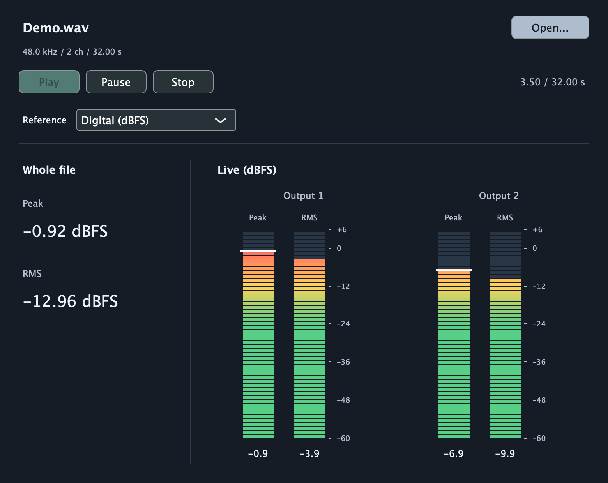
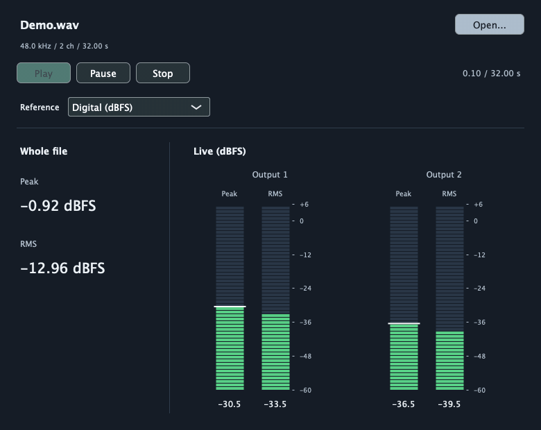

# Audio Level Analyzer

[](https://github.com/jci24/AudioLevelAnalyzer/actions/workflows/build.yml)

A native **JUCE 9 / C++20** desktop project for analysing audio files and monitoring
peak and RMS levels during playback. Built as a personal audio/software engineering
learning project, with an emphasis on understandable measurement code and testable behavior.



<details>
<summary>Watch the signal-response demo</summary>



</details>

The media is an offline-rendered preview using the same JUCE view and measurement
code as the app, not a screen recording. [Reproduce the preview](Tools/README.md).

## What it does

- Loads audio files and calculates whole-file sample peak and RMS in bounded chunks.
- Plays, pauses, and stops files with sample-rate conversion through JUCE.
- Displays per-output vertical meters with 100 ms RMS windows, transient peak capture,
  a one-second peak hold, and time-based visual release.
- Defaults to digital levels; supports explicitly calibrated or simulated SPL.

**SPL needs calibration.** An ordinary WAV or MP3 does not establish physical sound
pressure. Simulated SPL uses an assumed pascals-per-sample factor and is labeled as such.
Playback readings describe the digital output stream, not sound pressure at your ears.

## Build and run on macOS

Requirements: Xcode with command-line tools, CMake 3.24+, and Ninja.
The first configure downloads a pinned, SHA-256-verified JUCE source archive.

```sh
brew install cmake ninja
cmake --preset debug
cmake --build --preset debug
open "build/debug/AudioLevelAnalyzer_artefacts/Debug/Audio Level Analyzer.app"
```

In VS Code, open this folder and install the recommended C/C++, CMake Tools, and
CodeLLDB extensions. **Cmd+Shift+B** builds; **F5** builds and debugs. Restart VS Code
if it was open before installing the build tools. No Projucer setup is needed.

Click **Open...**, choose a file, then use **Play**, **Pause**, and **Stop**.
The reference selector defaults to **Digital (dBFS)**. Calibration controls appear
only in SPL modes. Hover over controls and measurements for their definitions.

To reproduce the demo without downloading third-party audio:

```sh
python3 Tools/generate_demo.py
```

Open `build/demo/Demo.wav`. Its stereo 440 Hz tones step through several amplitudes
and silence; the right channel is half the left channel's amplitude.
The rendered image and animation use this synthetic file.

## Verify the measurements

```sh
cmake --preset debug
cmake --build --preset tests
ctest --preset debug
```

Seven CTest suites cover known peak/RMS values, calibration, file-reading boundaries,
stereo energy, sample-rate-dependent windows, transient capture, playback resets,
and peak-hold/release timing. Playback-meter tests render the real JUCE transport and
resampler offline, without opening an audio device. Tests follow Arrange–Act–Assert.
GitHub Actions builds and tests both Debug and Release on macOS.

## Code tour

| Folder | Responsibility |
| --- | --- |
| [`Source/Application`](Source/Application) | Native app entry point, use-case coordination, and view layout |
| [`Source/Analysis`](Source/Analysis) | Sample peak/RMS, SPL conversion, and whole-file analysis |
| [`Source/Playback`](Source/Playback) | File transport, output device, and audio-thread meter publication |
| [`Source/Metering`](Source/Metering) | Windowed measurement, visual ballistics, and meter drawing |
| [`Tests`](Tests) | Matching analysis, playback, and metering checks |
| [`Examples`](Examples) | Standalone sine-wave sample experiment |

Start with [`MainComponent`](Source/Application/MainComponent.cpp) for the application
flow. [`AnalyzerView`](Source/Application/AnalyzerView.cpp) owns widget setup and layout;
measurement functions do not depend on the window.

- [Architecture and thread ownership](docs/architecture.md)
- [Measurement definitions and calibration](docs/measurements.md)
- [Questions to understand and explain the design](docs/design-walkthrough.md)

## Scope and limitations

This is a macOS-validated prototype, not a certified sound level meter. It measures
sample peak, not reconstructed true peak. RMS uses an unweighted mathematical reference,
not LUFS or standardised sound-level-meter time weightings. There is no microphone input
or seeking UI. More than two file channels can be analysed, but playback uses the first two.
Other operating systems, broad device compatibility, and production reliability are not validated.

## License

[AGPL-3.0-only](LICENSE). JUCE is a separately licensed dependency; see its
[license](https://github.com/juce-framework/JUCE/blob/9.0.5/LICENSE.md).
