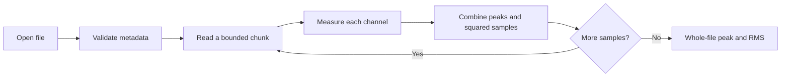
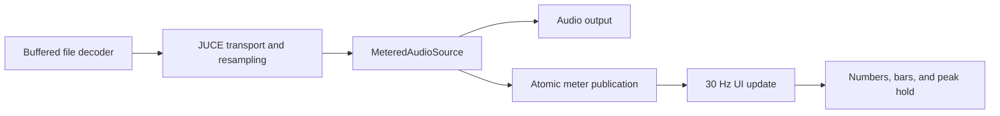

# Architecture

The project groups files by responsibility rather than introducing a framework
of repositories, services, and interfaces. JUCE already supplies the transport,
decoders, device manager, and native component abstractions.

## Reading order

1. `Source/Application/Main.cpp` creates the native window.
2. `MainComponent` wires user actions, owns the file-analysis worker, coordinates
   playback, and converts readings into the selected display reference.
3. `AnalyzerView` owns widget setup, layout, and view updates. Its callbacks report
   user intent; it does not read files or own audio-device state.
4. `Source/Analysis/AudioFileAnalysis.cpp` opens, validates, scans, and summarises a
   file. Its named calculation helpers are separate from the chunk-reading loop.
5. `Source/Playback/FilePlayer.cpp` owns JUCE's transport, read-ahead thread,
   decoder source, output device, and metered source.
6. `Source/Metering/LiveLevelMeter.cpp` owns one channel's 100 ms RMS window.
   `MeterBallistics` and `LevelMeterComponent` handle UI movement and drawing.

## File analysis

Analysis runs on a `std::jthread`, not the message thread. It checks cancellation
between chunks. Results are posted to the message thread with a JUCE safe pointer;
errors and cancelled scans do not become displayed measurements. Window shutdown
requests cancellation and joins the worker.

## Playback and meter publication

| Execution context | Owns |
| --- | --- |
| Message thread | Controls, reference selection, view, visual ballistics |
| Analysis worker | Separate whole-file decoder and bounded analysis buffer |
| JUCE read-ahead thread | Playback file buffering |
| Audio callback | Live RMS accumulators and pending interval peaks |

The custom measurement callback does not allocate memory, draw, access files,
or add a mutex. This is a statement about the added meter code, not a claim
that JUCE's entire transport/device pipeline is lock-free or hard real-time.
JUCE manages its own buffering and synchronisation.

### Why a click between UI frames is retained

The audio callback processes many blocks while the UI waits for its next frame.
Replacing a displayed value with every block's peak could erase a brief click.
Instead:

1. The audio thread retains the maximum of its pending peak and each block peak.
2. It publishes the values, followed by a publication sequence number.
3. The UI reads a sequence and the published values, then acknowledges that sequence.
4. The audio thread clears its pending peak only when that exact publication has
   been acknowledged. If it advanced during the UI read, it retains the peak for
   another refresh, avoiding loss.

Only the audio thread changes its accumulators. UI reset requests increment a
generation counter. Readers reject publications from an older generation until
the audio thread resets its own state. Pause/end-of-file also gate visible readings.
The publication assumes one audio producer and one UI consumer. Atomics are checked
at compile time to be lock-free on the build platform.

The offline playback tests exercise rendered output, transients between reads,
reset generations, end-of-file, and restart. They do **not** constitute a concurrent
stress test, a thread-sanitizer result, or proof of production reliability.

## Why these boundaries

- Numeric functions are independent of JUCE widgets and easy to check against known values.
- File analysis and playback use separate decoders, so scanning does not move the playback cursor.
- Visual release/hold are separate from measured levels, so readable movement does not change the data.
- View extraction keeps widget styling/layout out of use-case coordination.
- Concrete JUCE types remain where there is one implementation. Interfaces or mocks should
  be introduced for a real substitution/testing need, not to decorate the architecture.

Tests mirror `Analysis`, `Playback`, and `Metering`. The assertion helper stays in
`Tests/Support`. Plain C++ AAA tests are run as seven suites by CTest; no mocking
framework is needed for the current numeric functions.
